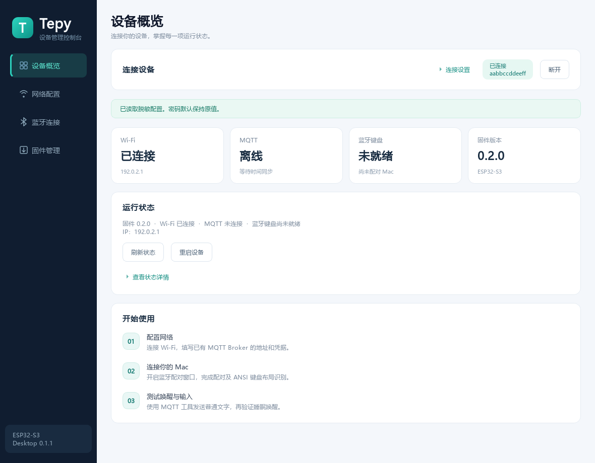
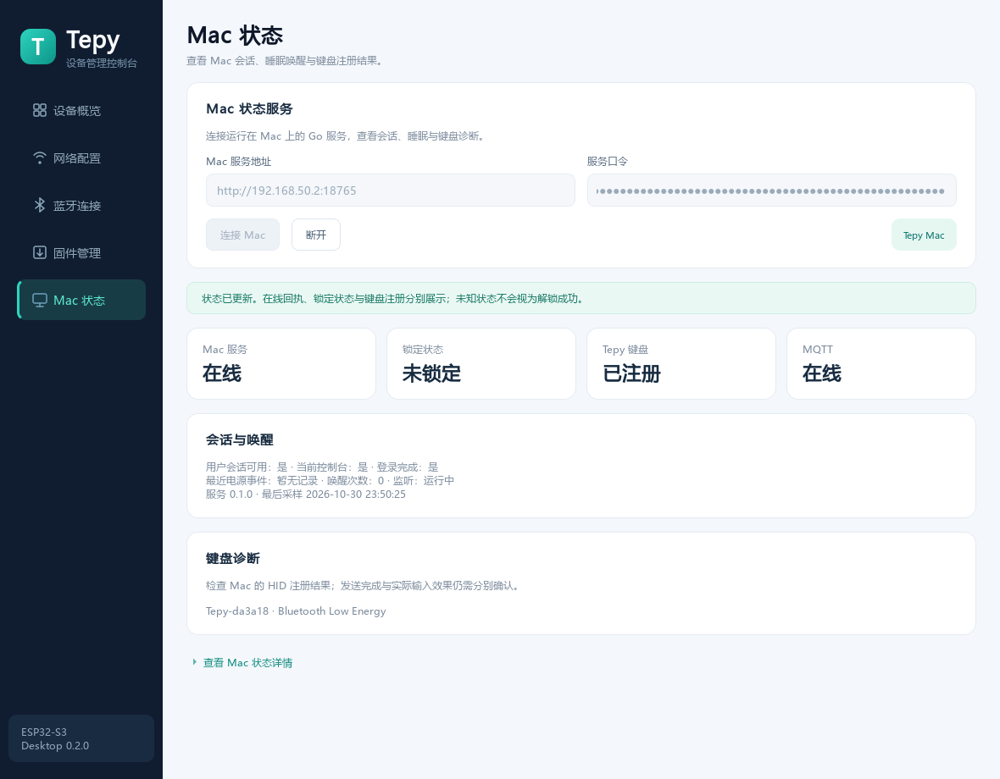

# Qt 桌面管理工具

当前桌面版本 **0.3.0**，使用 Qt Widgets / QSerialPort / Qt MQTT / C++23；USB 管理需要 **固件 0.2.0 或以上**。Mac 状态页连接 **Go Agent 0.1.0**。

## 启动

Windows 使用带版本的 `dist/tepy-desktop-0.3.0/`，双击其中的 `tepy-desktop.exe`。分发时保留整个目录，不能只复制 EXE。构建脚本的 `-Package` 默认输出 `dist/tepy-desktop/`，可通过 `-PackageDirectory` 指定目录。普通管理及键盘控制不需要 Python 或 ESP-IDF；仅 USB 刷机需要已安装 esptool 的 Python。

界面分为设备概览、网络配置、蓝牙连接、固件管理、Mac 状态、键盘控制。ESP32 连接成功后自动收起连接表单，需要查看时展开“连接设置”。设备状态每三秒刷新，刷新不会覆盖尚未保存的配置编辑。

0.3.0 的 MQTT 唤醒、文字、组合键与单次解锁流程，以及服务地址／口令的跨次恢复，见 [键盘控制与连接记忆](keyboard-control.md)。服务口令由系统凭据库保存；键盘输入不保存。启动时恢复表单，不自动连接或执行动作。左下角可清除保存的连接。

从 0.1.1 起，定时读取不再禁用按钮或表单，也不移动输入焦点。保存、配对和升级等用户操作优先于后台读取；进行中的写操作仍互斥，不会被轮询取消或自动重发。未变化的样式不重复应用，隐藏的 JSON 详情不重建；详情打开时保留滚动位置，正在选择文本复制时暂缓更新。升级桌面程序后需关闭旧窗口并重新打开，新功能不需要重新烧录固件。



截图使用测试夹具数据，设备 ID 和连接状态不代表当前真实设备。

## Mac 状态

1. 左侧选择“Mac 状态”，此页可以独立于 ESP32 连接使用。
   0.3.0 在“键盘控制”页连接 MQTT 后会自动显示指定代理的有效状态；以下为可选 HTTP 诊断方式。
2. 填写 Mac 服务地址，2026-10-31 当前地址为 `http://192.168.50.246:18765`。
3. 从 Mac 的 `~/Library/Application Support/Tepy/agent.toml` 读取 `http.token`，填入“服务口令”，点击“连接 Mac”。本次生成的本机副本为 `apps/macos-agent/agent.local.toml`，已被 Git 忽略。
4. 查看服务在线、锁定、Tepy 键盘注册、MQTT 和电源事件；详细 JSON 可按需展开。



上图来自 2026-10-30 目标 Mac 的真实只读接口，口令已遮蔽，截图中的 IP 是当时地址。HTTP 每五秒刷新；Mac 服务口令独立于 ESP32 管理口令，0.3.0 起由系统凭据库记住。网络不可达或状态过期时显示未知，恢复后继续读取；口令错误、地址重定向或服务身份改变时停止，需核对后重新连接。

Mac IP 变化后改填新地址。首次启动尚未观察到锁定事件时可能显示“未知”，不能推定为未锁定；键盘已注册也不代表密码输入成功。此页只观察状态，不执行解锁。安装、TOML／证书配置和状态边界见 [Mac 服务文档](macos-agent.md)。

## HTTP 连接

1. 电脑连接设备所在局域网，或连接 Tepy 的配置热点。
2. 选择“HTTP 网络”，填入设备地址和管理口令，点击“连接并读取”。
3. 热点地址通常为 `http://192.168.4.1`；已配网设备使用实际 IP，例如 `http://192.168.50.240`。也可使用 `http://tepy-<完整 device_id>.local`。
4. 成功后查看 Wi-Fi、MQTT、BLE 和固件版本卡片；原始 JSON 在“查看状态详情”中。

这里填写 ESP32 的地址，MQTT Broker 地址在“网络配置”页填写。固件管理 HTTP 用于受信局域网或 WPA2 热点，不映射公网。客户端拒绝重定向；HTTPS 地址按系统信任规则校验证书，不提供忽略证书错误的开关。

## USB 连接

1. 使用支持数据的线连接 ESP32-S3 的**原生 USB Serial/JTAG 接口**。板上若有两个 USB 口，USB-to-UART 口目前只用于原有控制台／下载，未实现此串口管理协议。
2. 退出 `idf.py monitor`：在 monitor 窗口按 `Ctrl+]`。同一串口不能被两个程序同时打开。
3. 选择“USB 串口”，刷新列表并选择端口，例如 COM7，填写管理口令后连接。
4. 不需要先加入 Wi-Fi，即可读取状态、修改 Wi-Fi / MQTT、配对与重启。网络 OTA 仍使用 HTTP；USB 升级使用“USB 刷机与恢复”。

USB 连接也要求管理口令，不因插线而跳过鉴权。该接口只管理设备，不接收 `type_text` 或其他键盘动作。

若没有管理口令，先用 monitor 打开串口，在**设备运行时**长按 BOOT 三秒，读取 `Admin token`；退出 monitor 后再使用 Qt。不要在上电时一直按住 BOOT。Qt 不展示普通串口日志和恢复凭据，避免将密码放入常规日志窗口。

## 保存 Wi-Fi / MQTT

连接后自动读取脱敏配置；只有读取成功才可保存。扫描 Wi-Fi 后选择网络可填入 SSID，也可手动填写。

密码选项明确区分：

- **保留原值**：请求中省略密码字段，设备原密码保持不变。
- **设置新值**：填写新密码后发送；不会读取或回显原密码。
- **清除**：显式传空字符串，用于开放 Wi-Fi 或无密码的 Broker。管理口令不可清除。

MQTT 地址示例：`mqtt://192.168.50.10:1883` 或 `mqtts://broker.example.com:8883`。用户名和密码单独填写。自签 CA 可在“自定义 CA 证书”中导入 PEM，最长 8192 字节，不能包含私钥；为空时使用固件证书包。

“高级设置”包含 NTP、按键间隔和管理口令。改变管理口令后，工具在收到保存成功回复时更新当前连接口令；请自行妥善保存新口令。

点击“保存到设备”后，到“设备概览”点击“重启设备”。更换 Wi-Fi 后，按新的 IP 重新连接。保存超时表示结果未确认，不会自动重发；先重新读取配置。若请求同时修改了管理口令，重新连接时可能需要使用新口令。

## 蓝牙

开启 120 秒配对窗口，然后在 Mac 蓝牙设置连接 Tepy。若 Mac 显示六位码，在工具中提交。已有绑定的设备会自动重连；只有更换目标 Mac 时才使用“断开并清除绑定”。清除绑定前有明确确认。

键盘设置助理要求识别布局时，可在“键盘控制”页发送单键 z、/ 并选择 ANSI；也可继续使用 Python MQTT 工具，详见 [首次使用](getting-started.md)。唤醒、文字和解锁均不自动重试密码。

## 固件管理

**网络升级**：使用 HTTP 连接，选择 `tepy.bin`。客户端先检查 ESP32-S3、项目 `tepy` 和 4 MiB 大小上限；设备仍执行完整镜像校验。确认后显示上传进度，成功则重启。重新连接并查看版本，才能确认新固件已经运行。不要选择 `tepy-merged.bin`。

**USB 刷机与恢复**：选择同一次 IDF 构建的 `flasher_args.json`，保留清单引用的目录和 BIN，选择下载串口及含 esptool 的 Python。已安装 IDF 的本机可使用 `C:/Espressif/tools/python/v6.1/venv/Scripts/python.exe`。普通 Python 也可安装 `esptool>=5,<6` 后使用。

工具仅接受 Tepy 当前 N16R8 分区布局，写入四个分段，不主动擦除 NVS。开始烧录前释放本工具串口；外部 monitor 需先退出。esptool 输出显示于烧录区域。操作完成前阻止关闭窗口，结果不确定时不自动重复。

镜像校验和恢复细节见 [OTA 与串口恢复](ota.md)。

## 源码、构建与测试

源码独立于固件：

```text
apps/desktop-qt/
├── CMakeLists.txt
├── src/
│   ├── main.cpp                 # QApplication / 启动检查
│   ├── main_window.*            # 页面组装与交互
│   ├── ui.*                     # 卡片、图标、配色与公共样式
│   ├── config_form.*            # 配置字段与密码操作
│   ├── device_client.*          # HTTP / USB 管理请求
│   ├── agent_client.*           # 独立的 Mac 状态 HTTP、身份与租约校验
│   ├── agent_page.*             # Mac 会话、键盘与电源状态页
│   ├── mqtt_control.*           # Qt MQTT、TLS、状态租约与当前动作回执
│   ├── keyboard_job.*           # 单次唤醒／输入与解锁执行流程
│   ├── keyboard_page.*          # MQTT 连接及键盘操作页
│   ├── connection_store.*       # QSettings 和系统凭据库
│   ├── serial_port.*            # 独立线程中的 QSerialPort
│   ├── protocol.*               # 分帧、路由、镜像和烧录清单
│   └── flash_job.*              # 异步 esptool 进程
└── tests/                      # desktop_tests.cpp / mqtt_tests.cpp
```

依赖：Qt 6.8 以上的 Widgets / Network / SerialPort / Mqtt / Test，CMake 3.22 以上、Ninja、C++23 编译器。本机使用 Qt 6.12.0。缺少 MQTT 模块时，先运行 `tools/dev/desktop-deps.ps1`；它固定下载并校验官方 6.12.0 源码，仅安装到工作区 `.venv/qtmqtt/install`。使用其他 Qt 版本时安装匹配版本的 MQTT 模块。来源、Hash 和许可见 `apps/desktop-qt/THIRD_PARTY.md`。

在仓库根目录：

```powershell
.\tools\dev\desktop.ps1             # 构建并运行自动测试
.\tools\dev\desktop.ps1 -Run        # 构建、测试并打开窗口
.\tools\dev\desktop.ps1 -Package    # 生成含 Qt DLL / 插件的运行目录
```

脚本默认路径对应本机安装，可通过 `-QtPath` 和 `-CompilerPath` 修改。Qt Creator 直接打开该目录的 `CMakeLists.txt` 并选择已安装 SerialPort 的 Kit。

其他平台可独立构建：

```sh
cmake -S apps/desktop-qt -B apps/desktop-qt/build -DCMAKE_PREFIX_PATH=/path/to/Qt
cmake --build apps/desktop-qt/build
ctest --test-dir apps/desktop-qt/build --output-on-failure
```

macOS / Linux 尚未构建与实测，不将共用 QSerialPort 源码等同于平台验收通过。

Qt 测试覆盖流式分帧、HTTP 请求／鉴权／重定向错误、密码省略与显式清除、UTF-8 长度、镜像和 NVS 区域保护、上传字节、超时不重试、窗口初始化与连接读取流程。测试报告在 `apps/desktop-qt/build/desktop-tests.txt` / `.xml`。

MQTT 执行、断线不重放、当前 session、retained／错 ID 回执拒绝、Mac 未知／未锁定不输入、页面清理和系统凭据库随机条目检查见 `mqtt-tests.txt` / `.xml`。凭据库检查只创建并删除随机测试档案，不修改实际连接；受限运行环境需允许当前用户的系统凭据库访问。设置 `TEPY_TEST_MQTT_URL`、`TEPY_TEST_MQTT_DEVICE`、`TEPY_TEST_MQTT_AGENT` 可增加真实 Broker 的只读观察，不发送动作。

Mac 页测试另覆盖状态结构和过期拒绝、Bearer 只读请求、服务身份改变及页面连接。设置 `TEPY_TEST_AGENT_URL` 和 `TEPY_TEST_AGENT_TOKEN` 后，可运行到目标 Mac 的只读检查；口令只通过环境传入，不写测试报告。设置 `TEPY_TEST_PREVIEW` 时另保存遮蔽口令的页面预览。完整记录见 [测试文档](testing.md)。

可选硬件检查需要显式设置环境变量：

```powershell
$env:TEPY_TEST_SERIAL = 'COM7'
$env:TEPY_TEST_APPLICATION = (Resolve-Path firmware/build/tepy.bin).Path
.\tools\dev\desktop.ps1
Remove-Item Env:TEPY_TEST_SERIAL, Env:TEPY_TEST_APPLICATION
```

串口检查只发送一个故意错误的管理口令，要求真实固件返回拒绝，不写配置或产生按键。正常配置写入、配对及 OTA 端到端验收需另行进行，见 [验证记录](testing.md)。
