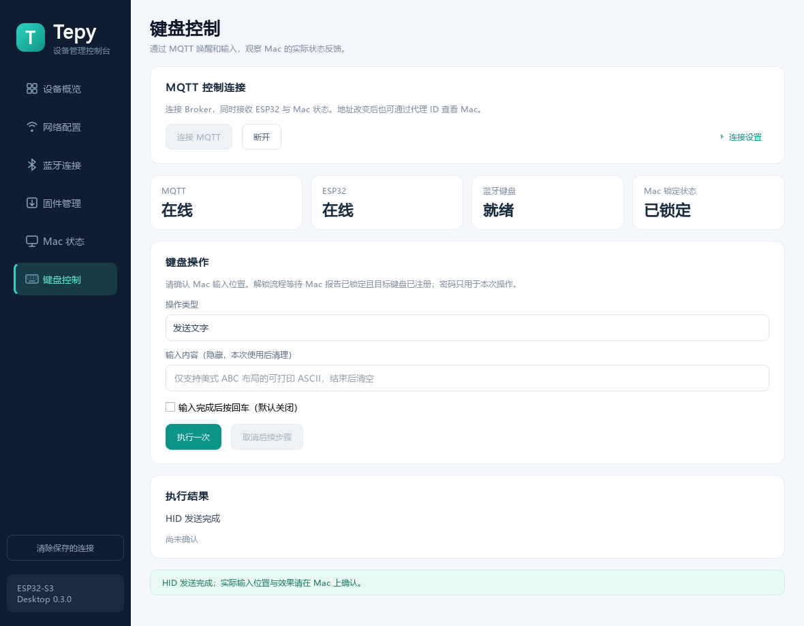

# Qt 键盘控制与连接记忆

Qt Desktop **0.3.0** 增加 MQTT 键盘控制，兼容现有固件 **0.2.0** 和 Mac Agent **0.1.0**，本轮不需更新这两端。

## 首次连接

打开 `dist/tepy-desktop-0.3.0/tepy-desktop.exe`，左侧选择“键盘控制”。

| 字段 | 当前环境示例 |
| --- | --- |
| Broker 地址 | mqtt://127.0.0.1:1883（Broker 在本机 Windows 上） |
| ESP32 设备 ID | 24587cda3a18 |
| Mac 代理 ID | mac-51958cda3625，以 Mac TOML 的 agent_id 为准 |
| 用户名／Broker 密码 | 无认证时留空；需要时单独填写 |

Qt 默认使用 `mqtt://127.0.0.1:1883`；本次已在该地址验证收到两端状态。Mac 和 ESP32 继续使用它们可达的 `mqtt://192.168.50.99:1883`。如果 Qt 在另一台电脑上运行，或使用远程 Broker，请改填它可达的 Broker 地址。此处不能填写 ESP32 或 Mac 的 HTTP 地址。

点击“连接 MQTT”，连接成功后配置栏自动收起，可展开“连接设置”查看。卡片显示 Broker、ESP32、BLE 和 Mac 状态。Mac 代理 ID 可留空使用普通唤醒／输入；“唤醒并输入解锁”需要它。已连接 ESP32 管理接口时，空的设备 ID 会从设备状态补入。

截图使用本机测试 Broker 和虚构设备数据，不代表当前真实 Mac 状态。Mac 的最新 MQTT 状态也会显示在“Mac 状态”页；主动连接 HTTP 诊断后，该页优先展示 HTTP。使用 MQTT 时不用填写 Mac IP，DHCP 地址变化不影响按 agent_id 订阅。

## 四种操作

- **唤醒屏幕**：发送一次 Shift 按下与释放。
- **发送文字**：1–512 个可打印 ASCII 字符，使用 Mac 的美式 ABC 布局；内容隐藏，点击执行后立即清空输入框。回车默认关闭。
- **发送按键／组合键**：按键名或单个字符，可组合 CTRL、SHIFT、ALT、GUI。ALT 对应 Option，GUI 对应 Command。支持 ENTER、TAB、ESC、BACKSPACE、DELETE、SPACE、方向键、HOME、END、PAGEUP、PAGEDOWN、CAPSLOCK、F1–F12。例如键盘布局助理可发送 z 和 /。
- **唤醒并输入解锁**：先验证全部输入，发送 wake，收到设备 sent 后等待指定间隔，默认三秒。再等待唤醒回执之后采样的 Mac 状态，确认当前 GUI 用户已登录、仍锁定、状态为 awake、目标 Tepy 键盘已注册，才提交一次输入。可选回车默认关闭。

解锁额外等待 Mac 有效状态最多二十秒；未知、离线或目标键盘不匹配时不输入密码。Mac 已报告未锁定时不发送密码。状态不能保证密码框焦点，使用者仍需确认目标 Mac 的界面与键盘布局。此流程不提供 FileVault 开机解锁。

界面将 **HID 发送结果** 与 **Mac 状态反馈** 分开。输入回执为 sent 后，最多观察二十秒新的 Mac 状态；未观察到解锁只显示未确认，不再次发送密码。在线、发送成功或键盘注册不等于登录成功。

## 取消与故障

任一时刻只执行一个键盘任务。网络断线、设备会话改变、BLE 不再就绪或状态过期，会停止后续步骤。MQTT 自身可重连，重连创建新客户端及干净会话，不恢复旧动作。忙碌、鉴权拒绝或回执超时均不会自动重试。

“取消后续步骤”会清理本次待输入内容并停止客户端等待；已提交的设备动作无法撤回，设备可能仍在输入。关闭窗口前先等待任务完成或取消后续步骤。不要把取消当作 ESP32 的紧急停止命令。

MQTT 命令 QoS 1、retain=false，含唯一 ID、当前 ESP32 session 和十秒过期时间。只接受当前请求的非 retained 回复。Broker PUBACK 六秒未确认则断开本次连接；HID 回复等待按最大按键间隔计算，最长文字可能需要约四分钟。超时结果未确认时请人工检查，不重复点击尝试密码。

ESP32 状态需最近十五秒采样、与本机时间相差不超过允许范围、在线、已校时、BLE ready、MQTT connected 且不忙碌。Mac 状态按 valid_until 判断有效性；过期显示未知。完整协议见 [协议文档](protocol.md)。

## 记住服务地址和口令

ESP32 管理、Mac HTTP、MQTT 分别记住最后一次连接信息。编辑完成或点击连接时保存，重开程序后自动恢复表单，**不会自动连接或执行键盘动作**。

地址、用户名、设备／代理 ID 和证书路径由 QSettings 保存；服务管理口令和 Broker 密码通过系统凭据库保存：

- Windows：当前用户的 Credential Manager，目标名以 `Tepy.Desktop.v1/` 开头。本轮已验证写入、恢复和删除。
- macOS：实现使用当前用户 Keychain；Qt macOS 构建及实机保存仍待验收。
- 其他平台：未提供安全凭据存储时报告保存失败，不退回明文保存口令。

Windows 非秘密设置位于当前用户注册表 `Software\Tepy\Desktop`。凭据库保存失败会提示，本次连接仍可用。证书只记路径，私钥内容不会复制进普通设置。管理口令修改成功后，同步更新本机保存的设备口令。

左侧“清除保存的连接”经确认后断开连接，清除本机三个连接档案及其服务口令，不修改 ESP32 或 Mac 配置。键盘输入框中的文字／Mac 登录密码始终不进入这些档案，不记录到日志或执行历史。输入框、待执行缓冲在使用、取消或失败后清理；Qt／网络框架内部临时副本不能承诺全部原地擦除。

## MQTT TLS

使用 `mqtts://broker.example.com:8883`，展开“TLS 证书设置”。CA 留空使用系统信任库，自定义 CA 可选择 PEM；客户端证书和未加密 PEM 私钥须成对选择，支持 RSA／EC 密钥。明文 mqtt:// 不接受证书配置。保持 TLS 1.2 以上、服务端主机名和证书校验，没有忽略错误开关。

本轮已验证 TLS 配置校验与错误证书拒绝；真实 TLS／mTLS Broker 的端到端验收仍需另行执行。
